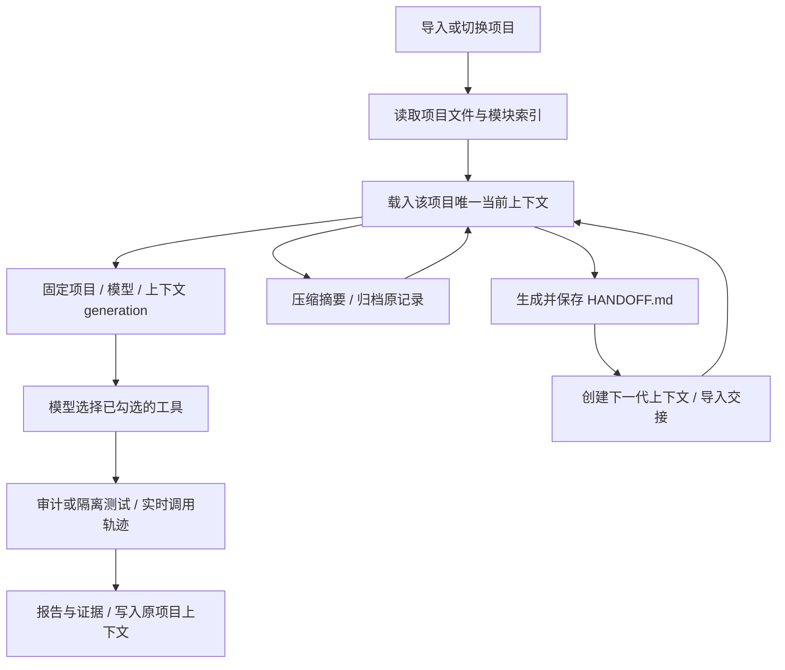

# 项目与上下文实施约定

用户已要求继续实现；沿用现有 Terminal CLI 桌面界面及本地隔离执行规则。

1. 项目列表持久化目录、名称、索引信息和专属上下文 ID。项目切换时重新验证目录，源项目文件不删除。每个项目恰好一个当前上下文；不同项目的消息、摘要、用量、交接文档互不混用。任务固定绑定开始时的项目、模型地址/名称/密钥和上下文 generation；最大输出 token 修改并保存后，同步到下一次内置模型调用，已发送请求保持原值。
2. 上下文容量提供 8K–2M 预设，其中 1M=1,000,000 token。配置与监控容量同步；用量分别标记实际 API token 和本地估算的持久记忆占用。实际模型必须支持所选容量；应用不会宣称远端上限已变更。
3. 压缩通过已配置模型总结当前项目目标、事实、决策、进度、问题、证据位置、下一步与未验证事项；原记录归档，摘要成为有效记忆。重置先生成并保存 HANDOFF.md，再创建新 generation，导入交接内容作为种子，旧记录保留。失败时不切换、不清空原上下文。正在运行的同项目任务完成后才能压缩或重置。
4. 用户继续使用现有 Skill 导入/编辑功能。新增容器命令工具注册：名称、描述、参数数组、可选本地镜像与启停；模型只能请求已启用工具，工具默认在本地项目副本使用当前用户权限执行（运行前确认），可选无外网、只读源副本、资源受限 Docker 容器。结果及调用记录写入项目上下文，所有模式均使用 argv，不拼接主机 shell 命令。
5. 用户已取消对话窗，不实现用户聊天。注册工具可手动运行，也可为审计/测试任务勾选后由模型在任务执行中选择调用；只允许该任务选中的已启用工具。项目记忆用于后续审计/测试目标与交接，不作为通用聊天记录。

实施文件：src/workspace.ts、src/custom-tools.ts、src/main.ts、src/model.ts、src/ui/*；回归覆盖跨项目隔离、容量同步、压缩/重置失败保全、交接保存、工具隔离、无对话入口与原有实时流程图。

