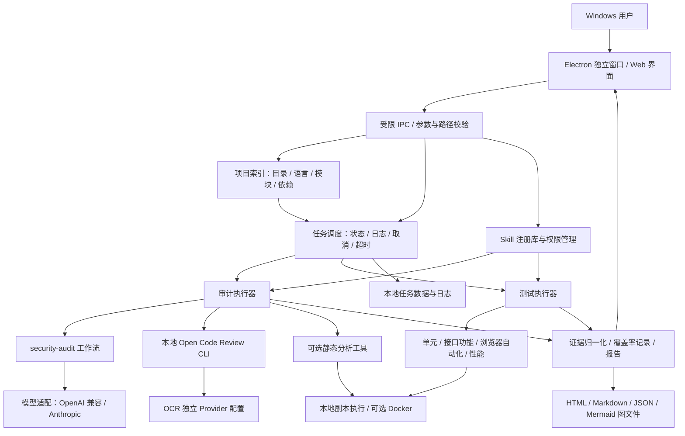
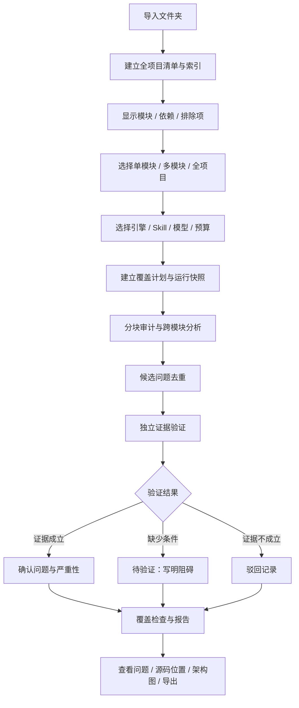
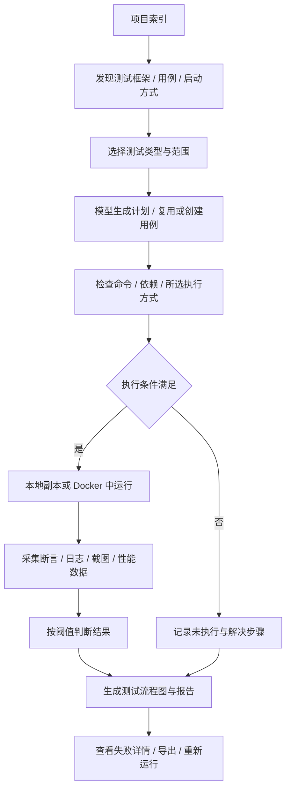
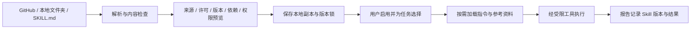

# 本地代码审计与软件测试桌面应用：已确认设计

日期：2026-11-11（America/Los_Angeles）。状态：用户已确认实施；实现状态与实际验证见 README.md 和 SELF-TEST.md。

实施修订：用户指定 Terminal CLI 黑底荧光绿等宽字体、零圆角与终端分栏；顶栏新增软件名称、实际系统联网/电量/时间，左侧新增 CPU/内存与 Token/上下文读数。Open Code Review 自动发现或安装，直接复用应用模型，无独立配置。五个 Skill 已下载并打包，初始星数表仅保留选型时快照。

## 1. 使用方式与技术方案

Windows 独立桌面窗口，内部使用 Web 页面。启动应用 → 选择项目文件夹 → 本地建立项目索引 → 在界面配置模型、审计或测试 → 查看进度、证据、图表和报告。

| 方案 | 适用性 | 取舍 |
| --- | --- | --- |
| Electron + TypeScript 本地服务（推荐） | 统一使用 Node.js，便于调用本机 OCR 和测试工具 | 安装包较大；需要下载 Electron |
| .NET + WebView2 | Windows 集成好 | 前后端需要两套运行与开发环境 |
| Python + WebView | 适合 Python 测试工具 | 桌面打包和多语言项目工具管理较复杂 |

默认采用推荐方案。业务服务运行在主进程或独立任务进程，通过受限 IPC 提供能力；界面没有 Node.js 权限，开启上下文隔离和沙箱，不加载远程页面。无需将控制接口暴露到局域网。

首版提供五个入口：项目总览、代码审计、软件测试、Skill 库、模型与报告。设置归入模型页面，历史报告可从任务列表打开。

## 2. 架构图

避免微服务、账户系统和远程任务集群。首版单机任务队列，模型并发可配置；任务数据保存在应用数据目录，原项目不作为结果输出目录。

## 3. 项目导入与完整阅读

先遍历整个项目的可访问目录并生成清单，再按预算读取可审查的源文件。默认排除版本库内部文件、依赖、构建产物、二进制、大文件及密钥文件。尊重忽略规则，允许界面调整；跳过原因必须可见。

记录每个文件的相对路径、大小、摘要、语言、读取状态和跳过原因；不跟随目录联接或符号链接逃出项目根目录。依赖关系根据导入语句与清单推导，动态导入或未知关系标记为推断或未知。

“索引整个项目”不等于“把整个项目一次塞入模型”。分块读取、建立摘要、按模块分析、跨模块复核；记录已读、已审计、失败、跳过和待处理文件。报告禁止把未覆盖文件算作已审计。

项目架构图根据实际索引与分析生成；没有明确依据的调用关系不得绘制为确定事实。

## 4. 审计能力与流程图

范围支持单个目录或文件、多个模块和整个项目；可选只读关联依赖。审计范围和上下文范围分别记录。

security-audit 是工作规范，不是 CLI。应用加载其关联规范，通过模型与受限工具实施侦察、覆盖计划、漏洞查找、独立验证、结构化检查和报告。不能仅把 SKILL.md 拼入提示词就宣称完整执行了该工作流。

全项目 OCR 使用 `ocr scan`；模块使用 scan 的路径范围；变更审查使用 `ocr review`。接入时先核对本机命令帮助，按实际版本启用参数；不支持全文件扫描时显示能力不足，不用 diff 审查冒充全项目审计。

报告包含来源引擎、范围、版本与文件摘要、规则、问题位置、边界与证据、最小修复建议、覆盖缺口及失败原因。security-audit 模式按其要求保留 confirmed / needs_validation / rejected，并执行配套 schema 与覆盖校验。OCR 原始结果单独保留，不将模型评论直接视作已独立确认漏洞。

取消必须停止受管进程树；超时、模型中断、预算耗尽显示部分完成，并保留已完成结果。不自动修改导入的项目。

## 5. 测试能力与流程图

| 类型 | 首版执行方式 | 证据 |
| --- | --- | --- |
| 单元测试 | 识别已有 Python / Node.js 测试命令；允许配置其他运行器 | 用例、断言、退出码、耗时、可用时的覆盖数据 |
| 功能测试 | 从接口定义或用户给出的预期生成 HTTP 检查 | 输入、预期、响应与断言结果 |
| 自动化测试 | Playwright 驱动测试环境中的 Web 界面 | 步骤、截图、浏览器日志、失败位置 |
| 性能测试 | 配置隔离环境的目标、并发、持续时间和阈值；适配可用运行器 | 吞吐量、错误率、P50/P95/P99、阈值比较 |

模型可生成计划和测试文件，生成文件写入任务工作区；优先复用已有用例。业务预期缺失时提示补充，探索性检查不能冒充业务验收。任意语言与任意框架不保证自动识别成功，未知项目通过显式运行器配置接入。

按用户最新要求，默认无需 Docker。测试与工具在项目内容副本运行，环境变量采用白名单，限制时间和输出，支持取消进程树。本地执行使用当前用户权限，可访问本机文件和网络，界面提交前明确确认；普通子进程不是 OS 安全沙箱。不可信项目可改选 Docker，继续校验无外网、只读挂载以及 CPU/内存/进程等上限。

需要本地客户端与服务端通信时，使用任务的回环地址；不直接压力测试生产地址，不把模型密钥传给目标项目。工具缺失时显示安装步骤，禁止在导入时执行项目安装脚本。

## 6. 模型配置

界面设置协议、Base URL、模型名、API Key、超时、上下文限制、并发与 token 预算；支持本地 OpenAI 兼容服务。提供显式连接测试，不能把任意文本响应当作有效模型调用。

密钥使用 Windows 用户级加密存储，不进入前端持久化、项目文件、进程参数或报告。OCR 配置采用其实际版本支持的独立 provider 机制；验证与主模型设置的映射，不能只保存 UI 配置却不传递给 OCR。

导入只做本地读取。首次运行前明确展示模型服务地址和将发送的代码范围；本地模型可以保留代码在本机。项目内容和 Skill 内容都视为数据，不能覆盖应用的路径、凭据和执行权限限制。

## 7. 可扩展 Skill 库

导入方式：GitHub 仓库及子目录、本地 Skill 文件夹、独立 SKILL.md。支持用户添加、编辑应用内副本、启用、停用、移除和为任务选择 Skill。使用本地副本，不修改 Codex 已安装的原件。

GitHub 导入分成获取元数据、选择具体 Skill、内容检查、保存锁定版本和启用。记录仓库、Skill 相对路径、commit SHA、内容哈希、许可证、仓库星数及查询时间。星数属于仓库，不属于单个 Skill；离线使用缓存并显示日期。

SKILL.md 校验名称和描述；关联 references / scripts 必须保留目录结构并限制大小。拒绝路径穿越、逃逸链接、重名覆盖和无界下载。没有明确许可证的内容可以记录候选来源，不默认打包分发。

导入不执行安装脚本。Skill 指令、关联文件与可执行工具分别管理；工具依赖缺失、仅支持 Bash、需要专有服务或不兼容 Windows 时显示“依赖未满足”，不假装可运行。外部 Skill 不能提升权限、读取凭据或绕过项目执行隔离。

默认候选来源（2026-11-11 查询 GitHub API；星数会变化；尚未安装）：

| 仓库 | 星数快照 | 选用内容 | 接入注意 |
| --- | ---: | --- | --- |
| trailofbits/skills | 8,142 | 静态分析、安全审计相关 Skill | 仓库 CC-BY-SA-4.0；逐项检查脚本、工具与授权要求 |
| anthropics/skills | 193,252 | webapp-testing | 具体 Skill 声明 LICENSE.txt；需核对该文件后再分发；依赖 Python / Playwright |
| obra/superpowers | 316,378 | test-driven-development | 仓库 MIT；用于用例设计流程，不能代替测试运行器 |

Semgrep、CodeQL、pytest、Playwright、k6 等属于执行工具，不因安装 Skill 就自动安装。性能测试优先提供已有运行器适配和阈值检查，不用无关高星 Skill 填充列表。

## 8. 测试报告与交付验收

每次任务生成真实报告；报告模板与实际执行报告明确区分。状态至少有通过、失败、未执行、取消和部分完成。无用例、无运行器或无沙箱不得显示通过。

报告记录项目快照、任务范围、模型、Skill 版本、执行命令的安全版本、起止时间、执行环境、用例统计、失败断言、日志与截图引用、性能配置与指标、覆盖缺口和重现步骤。敏感值不进入报告；导出 HTML 对代码与模型输出转义。

应用本身必须验证：导入中文和带空格路径；单模块与多模块边界；OCR 全文件模式；自定义 Skill 导入与停用；模型配置实际生效；任务取消与超时；真实测试结果解析；报告可打开；界面键盘可用；原项目不被无意写入。联网模型与 OCR 实测只有在用户完成凭据配置后才能声称通过。

实施分成可验收的四段：桌面与索引 → 模型、Skill 与审计 → 隔离测试与报告 → 端到端验证与 Windows 打包。最终提供启动入口、源码、使用说明、项目架构图、运行及测试流程图、应用自测报告和 Windows 安装包或明确的打包阻碍。

## 9. 已核对资料

- OCR 全文件扫描与范围参数：https://github.com/alibaba/open-code-review/blob/main/pages/src/content/docs/en/cli-reference.md
- 安全 Skill 来源：https://github.com/trailofbits/skills
- Semgrep Skill：https://github.com/trailofbits/skills/blob/master/plugins/static-analysis/skills/semgrep/SKILL.md
- Web 测试 Skill：https://github.com/anthropics/skills/blob/main/skills/webapp-testing/SKILL.md
- 测试开发 Skill：https://github.com/obra/superpowers/blob/main/skills/test-driven-development/SKILL.md

设计检查：已区分索引与审计覆盖、规范与执行器、计划与实际测试、仓库热度与 Skill 能力；外部 Skill 目前是候选，未声称安装或完成兼容验证。
